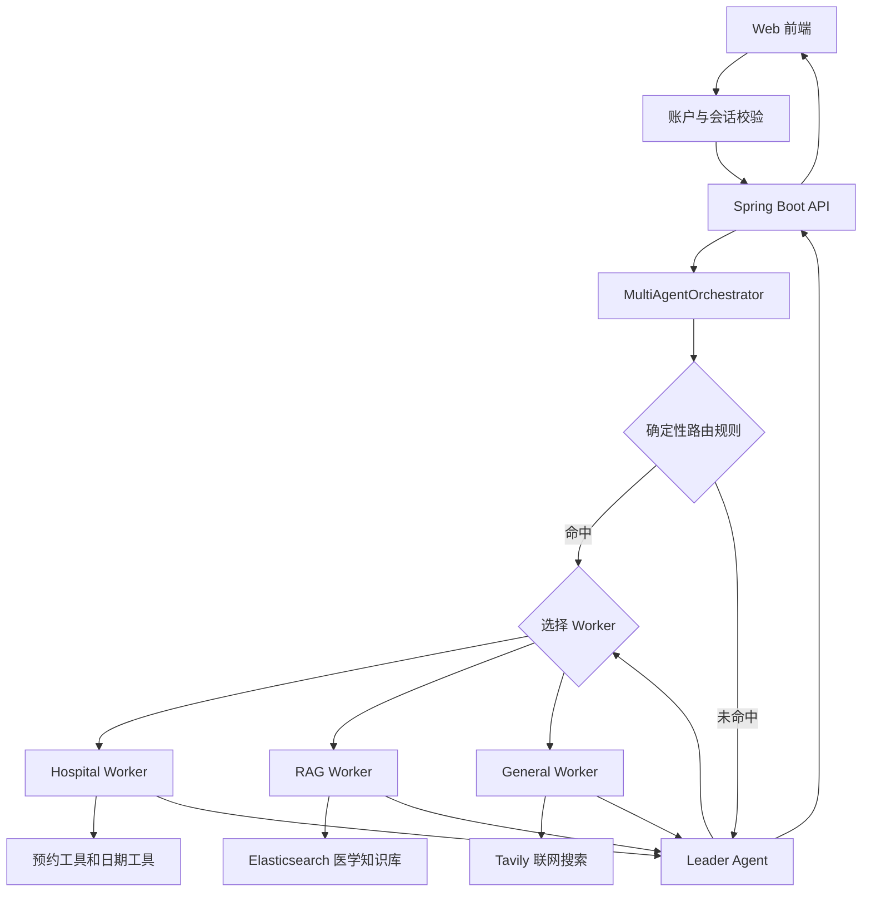

# 医疗小智

医疗小智是一个基于 Spring Boot 与 LangChain4j 构建的智能医疗助理项目。系统将医院业务办理、院内知识问答、互联网实时信息查询和医学报告分析整合到同一个 Web 应用，并通过 Leader + Worker 多智能体架构完成任务拆分、工具调用和最终答复。

> 本项目用于学习、演示和工程实践，不提供医学诊断，也不能替代医生面诊。涉及急症或严重不适时，应及时联系医疗机构。

## 核心能力

- 账户系统：支持注册、登录、退出和注销账户，密码使用 BCrypt 哈希存储。
- 用户数据隔离：会话、预约和智能体工作记忆均按账户隔离。
- 多会话聊天：一个用户可以创建、切换、清空和删除多个独立会话。
- 多智能体协作：确定性规则优先路由，Leader 负责兜底判断、任务交接和最终答复整合。
- 医院业务：支持分诊建议、医生与号源查询、预约、预约查询和取消预约。
- 医学 RAG：从审核后的医院科室资料中执行关键词、向量或混合检索，并展示引用来源。
- 实时信息：General Worker 通过 Tavily 查询新闻、天气、路线等时效性信息。
- 医学报告：支持上传 TXT、PDF、PNG、JPG/JPEG，完成文本提取、结构化和指标解释。
- 安全控制：限制文件类型与大小、隔离私有文件、日志脱敏，并阻止智能体伪造工具结果。

## 系统架构



三个 Worker 的职责如下：

| 智能体 | 职责 | 可用能力 |
|---|---|---|
| Hospital Worker | 分诊、排班、号源、预约、查询和取消预约 | `AppointmentTools`、`DateTools` |
| RAG Worker | 医院、科室、医学科普等院内知识问答 | Elasticsearch 检索与 RAG 上下文 |
| General Worker | 路线、天气、新闻和其他通用问题 | `WebSearchTool` |

Worker 的执行结果无论成功、失败还是需要补充信息，都会返回 Leader。Leader 可以继续调度其他 Worker 处理同一句话中的剩余子任务，最终只向前端输出一次整合后的用户答复。

## 记忆与数据存储

| 数据 | 存储位置 | 隔离方式 |
|---|---|---|
| 用户账户、医生、排班、预约 | MySQL | 预约通过 `user_id` 归属账户 |
| 会话列表与主会话消息 | MongoDB | 通过用户 ID 和会话 ID 隔离 |
| Hospital/RAG/General 私有记忆 | MongoDB | 使用独立的 Worker memory ID |
| 医学知识索引 | Elasticsearch | 独立索引配置 |
| 用户上传的医学文件 | `data/uploads/medical` | 不通过静态资源目录公开 |

主会话只保存用户与助手最终可见的内容。工具调用轨迹、检索结果和 Worker 内部状态保存在各自私有记忆中，不会展示到前端，也不会被其他 Worker 直接读取。

## 技术栈

- Java 17
- Spring Boot 3.2.6
- LangChain4j 1.0.0-beta3
- MyBatis-Plus 3.5.11
- MySQL
- MongoDB
- Elasticsearch
- 通义千问 DashScope
- Tavily Search
- PDFBox、PaddleOCR 或 DashScope OCR
- Knife4j / OpenAPI
- 原生 HTML、CSS、JavaScript

## 运行前准备

请先准备以下环境：

1. JDK 17。
2. Maven 3.8 或更高版本。
3. MySQL 8.x，并创建 `guiguxiaozhi` 数据库。
4. MongoDB，并创建或允许自动创建 `chat_memory_db` 数据库。
5. 可访问的 Elasticsearch 实例及医学知识索引。
6. 通义千问 API Key。
7. 如需联网搜索，准备 Tavily API Key。
8. 如需识别图片报告，启动 PaddleOCR HTTP 服务或配置 DashScope OCR。

MySQL 中需要预先存在以下业务表：

- `doctor_info`：医生资料。
- `doctor_schedule`：排班与剩余号源。
- `appointment`：预约记录。

应用启动时会自动创建 `app_user` 表，并为已有的 `appointment` 表补充 `user_id` 字段和用户状态索引。基础业务表及医生排班数据仍需在启动前准备好。

## 配置环境变量

项目通过 `application.properties` 中的以下配置加载根目录 `.env`：

```properties
spring.config.import=optional:file:.env[.properties]
```

PowerShell 中可以从模板创建本地配置：

```powershell
Copy-Item .env.example .env
```

然后修改 `.env` 中的占位值。建议至少检查以下配置：

```dotenv
SERVER_PORT=8080

QWEN_API_KEY=replace_me
QWEN_CHAT_MODEL=qwen-max
QWEN_STREAMING_MODEL=qwen-max
QWEN_EMBEDDING_MODEL=text-embedding-v3

MYSQL_URL=jdbc:mysql://localhost:3306/guiguxiaozhi?useUnicode=true&characterEncoding=UTF-8&serverTimezone=Asia/Shanghai&useSSL=false
MYSQL_USERNAME=root
MYSQL_PASSWORD=replace_me
MONGODB_URI=mongodb://localhost:27017/chat_memory_db

TAVILY_API_KEY=replace_me

ALIYUN_ELASTICSEARCH_ENDPOINT=https://replace_me:9200
ALIYUN_ELASTICSEARCH_USERNAME=replace_me
ALIYUN_ELASTICSEARCH_PASSWORD=replace_me
ALIYUN_ELASTICSEARCH_INDEX=xiaozhi-medical-knowledge
```

`.env` 已被 `.gitignore` 排除，不应提交真实密码或 API Key。`.env.example` 只保存变量清单和占位值，应继续保留在仓库中。

### RAG 配置

默认配置使用 DashScope 生成向量、在线模型生成答案，并通过 Elasticsearch 完成混合检索：

```dotenv
RAG_ANSWER_GENERATOR_MODE=online
RAG_EMBEDDING_PROVIDER=dashscope
RAG_RERANK_PROVIDER=dashscope
QWEN_RERANK_MODEL=qwen3-rerank
QWEN_WORKSPACE_ID=replace_me
```

知识源位于：

```text
docs/knowledge/raw/pumch/2026-07-31/department-pages
```

首次运行且不存在上传标记时，系统会在后台解析资料并写入 Elasticsearch。需要强制重建索引时，可以临时设置：

```dotenv
ALIYUN_ELASTICSEARCH_REBUILD_ON_STARTUP=true
```

重建完成后应恢复为 `false`，避免每次启动重复生成向量和写入索引。

### 医学报告 OCR 配置

默认使用 PaddleOCR HTTP 服务：

```dotenv
MEDICAL_OCR_PROVIDER=paddle
MEDICAL_OCR_BASE_URL=http://127.0.0.1:18080
```

也可以切换为 DashScope OCR：

```dotenv
MEDICAL_OCR_PROVIDER=dashscope
MEDICAL_OCR_API_KEY=replace_me
MEDICAL_OCR_ENDPOINT=https://replace_with_workspace_id.cn-beijing.maas.aliyuncs.com/compatible-mode/v1/chat/completions
MEDICAL_OCR_MODEL=qwen3.5-ocr
```

TXT 和含文本层的 PDF 可以本地提取；PNG、JPG/JPEG 以及扫描版报告需要可用的 OCR 服务。

## 启动项目

### Maven 启动

```powershell
mvn clean test
mvn spring-boot:run
```

### IDEA 启动

1. 通过项目根目录的 `pom.xml` 打开项目并执行 Maven Sync。
2. Project SDK 和运行 JRE 均选择 Java 17。
3. 运行主类 `langchain4j.XiaozhiApp`。
4. Run Configuration 的 `Use classpath of module` 选择当前 Maven 模块。

启动成功后访问：

- Web 页面：<http://localhost:8080/index.html>
- Knife4j 文档：<http://localhost:8080/doc.html>
- 配置检查：<http://localhost:8080/xiaozhi/readiness>

首次使用时先注册账户。登录成功后可以创建多个会话，所有会话和预约只对当前账户可见。

## 主要接口

| 模块 | 接口前缀 | 说明 |
|---|---|---|
| 认证 | `/api/auth` | 注册、登录、登录状态、退出、注销 |
| 智能对话 | `/xiaozhi/chat` | 多智能体流式对话 |
| 会话管理 | `/xiaozhi/conversations` | 创建、查询、改名、清空和删除会话 |
| 预约业务 | `/xiaozhi/appointments` | 号源、预约、查询和取消 |
| 医学 RAG | `/xiaozhi/rag` | 检索上下文、回答和评测样例 |
| 医学报告 | `/xiaozhi/medical-files` | 上传、提取、结构化、解释和删除 |

除注册、登录和 readiness 外，`/xiaozhi/**` 接口需要携带登录会话 Cookie。前端调用已统一设置 `credentials: include`。

## 测试

运行全部测试：

```powershell
mvn test
```

只运行多智能体路由回归测试：

```powershell
mvn -Dtest=RoutingAccuracy200Test test
```

路由测试包含 200 条公开用例，覆盖医院业务、RAG、通用问题和上下文承接：

- [路由测试用例](docs/routing-test-cases-200.md)
- [测试数据](src/test/resources/routing-test-cases-200.tsv)
- [测试代码](src/test/java/langchain4j/multiagent/RoutingAccuracy200Test.java)

仓库提供 `src/test/resources/application-test.properties`，需要 Spring 测试上下文的用例可以显式启用它，以使用确定性 embedding、抽取式 RAG 和独立测试目录。大部分单元测试通过 mock 或本地测试替身避免依赖真实在线服务。

## 项目结构

```text
src/main/java/langchain4j
├── assistant       # Leader 与三个 Worker 的 AI Service 定义
├── auth            # 注册、登录、会话认证和账户注销
├── config          # Agent、RAG、OCR、跨域和启动配置
├── controller      # HTTP 接口
├── memory          # 主会话、会话元数据和 Worker 私有记忆
├── multiagent      # 路由、协议解析、交接与结果整合
├── multimodal      # 医学文件上传、OCR、解析和解释
├── rag             # 医学知识导入、检索、重排和评测
├── service         # 预约、医生和排班业务
├── store           # MongoDB 聊天记忆存储
└── tools           # 预约、日期和联网搜索工具

src/main/resources
├── prompts         # 四个智能体的中文系统提示词
├── static          # Web 前端
├── langchain4j     # MyBatis XML
└── application.properties

docs
├── knowledge       # 经审核的知识源与清单
├── multi-agent-routing-architecture.md
└── routing-test-cases-200.md
```

## 常见问题

### IDEA 提示找不到 `langchain4j.XiaozhiApp`

确认项目是通过 `pom.xml` 导入的 Maven 项目，执行 Maven Sync，并检查 Run Configuration 的模块 classpath。删除 `.idea` 后，旧运行配置可能失去模块信息，需要重新选择主类和模块。

### 删除 `.env` 后会话记录消失

`.env` 中的 `MONGODB_URI` 可能与 `application.properties` 默认值不同。删除前应把相同变量迁移到 IDEA 或系统环境变量，否则应用可能连接到另一个 MongoDB 数据库。

### 图片报告可以上传但不能提取文本

检查 `MEDICAL_OCR_PROVIDER` 对应的服务是否启动、地址是否正确。PaddleOCR 默认地址是 `http://127.0.0.1:18080`；TXT 和文本型 PDF 不依赖 OCR。

### RAG 没有正确返回院内知识

检查 Elasticsearch 地址、账号、密码、索引名和 Qwen embedding 配置，并查看启动日志中的后台知识导入结果。必要时执行一次索引重建。

### 聊天报 404 Not Found（response_error）

`langchain4j-community-dashscope` 使用 DashScope 原生协议，会在 `base-url` 后拼接 `/services/aigc/text-generation/generation`。如果把 `langchain4j.community.dashscope.chat-model.base-url` 或 `streaming-chat-model.base-url` 配成业务空间专属的 `.../compatible-mode/v1` 地址，两种协议混拼后网关直接返回 404，日志表现为 `{"statusCode":404,"message":"Not Found","code":"response_error","isJson":false}`。

- 不要给 `chat-model` 和 `streaming-chat-model` 配置 `base-url`，让 SDK 使用默认地址 `https://dashscope.aliyuncs.com/api/`。
- `QWEN_CHAT_MODEL` 与 `QWEN_STREAMING_MODEL` 必须是原生端点支持的公共模型，例如 `qwen-plus`、`qwen-max`。
- 只在业务空间专属域名提供的模型（例如 `qwen3.8-flash`）需要改用 OpenAI 兼容客户端调用。`MEDICAL_OCR_ENDPOINT` 和精排端点是自行发起 HTTP 请求，可以继续使用 `/compatible-mode/v1`。
- 如果日志出现 `403 AllocationQuota.FreeTierOnly`，说明百炼账号开启了"仅使用免费额度"，需要充值或关闭该模式，与本项目配置无关。

### 启动被 Startup config validation failed 中断

`StartupConfigValidator` 读取的是裸环境变量 `QWEN_API_KEY`，不会识别 `application.properties` 中占位符的默认值。`STARTUP_VALIDATION_FAIL_FAST=true`（默认值）时，缺少该变量会直接终止启动。推荐在 IDEA 的 Run/Debug Configuration 的 Environment variables 中填写 `QWEN_API_KEY=...`；改完系统或用户环境变量后必须完全退出并重启 IDEA，否则新进程仍会带着旧值。

### Elasticsearch 返回 403 Forbidden: [no body]

先用 `curl.exe -u <用户名>:<密码> "http://<endpoint>/"` 查看响应体；`ip_not_in_whitelist` 表示当前公网出口 IP 未加入阿里云 Elasticsearch 的公网访问白名单。索引探测使用 `HEAD` 请求，按协议没有响应体，因此 Spring 日志只会显示 `[no body]`，真实原因需要按上面的方式单独确认。家庭宽带的出口 IP 会变化，切换网络后可能需要重新加白。

### 实时信息或路线查询超时

确认 `TAVILY_API_KEY` 有效且当前网络可以访问 Tavily。可通过 `TAVILY_CONNECT_TIMEOUT_MS` 和 `TAVILY_READ_TIMEOUT_MS` 调整超时时间。

## 安全说明

- 不要将 `.env`、数据库密码、API Key 或医疗文件提交到版本库。
- 生产环境应删除 `application.properties` 中的敏感默认值，只允许通过密钥管理服务或环境变量注入。
- 医学报告和身份信息属于敏感数据，应使用 HTTPS、访问控制、备份加密和明确的数据保留策略。
- 注销账户会删除该用户的会话、Worker 私有记忆和预约数据，该操作不可恢复。

## 相关文档

- [多智能体路由架构](docs/multi-agent-routing-architecture.md)
- [200 条路由测试用例](docs/routing-test-cases-200.md)
- [项目亮点](resume-highlights.md)
- [代码难点](代码难点.md)
- [项目遗留问题](项目遗留问题.md)
- [高频面试考点](高频面试考点.md)
